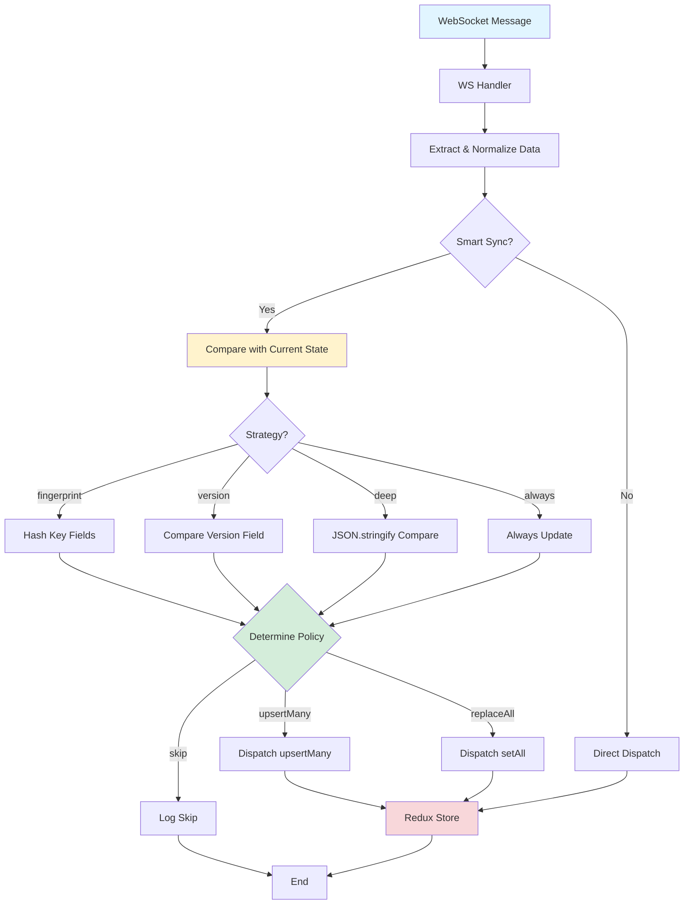

# Smart Redux Update System - Developer Guide

## Как это работает



---

## Архитектура

### 1. WS Event Registry (`wsEventRegistry.ts`)

Центральный реестр событий с метаданными:

```typescript
{
  event: 'user_join',
  targetSlice: 'players',
  compareStrategy: 'fingerprint',
  normalizer: normalizePlayers,
  selector: selectAllPlayers,
  idField: 'id',
}
```

### 2. Compare Strategies (`compareStrategies.ts`)

| Стратегия     | Когда использовать        | Сложность |
| ------------- | ------------------------- | --------- |
| `fingerprint` | Массивы с ID (players)    | O(n)      |
| `version`     | Объекты с версией/раундом | O(1)      |
| `deep`        | Малые объекты (settings)  | O(n)      |
| `always`      | Критичные события         | O(1)      |

### 3. Update Policies

```typescript
// Определяет как обновлять store
if (removedItems > 0) return 'replaceAll';
if (changedPercent > 50%) return 'replaceAll';
if (changedItems > 0) return 'upsertMany';
return 'skip';
```

### 4. Handlers

Handlers вызывают `smartSyncPlayers` или `logEventReceived`:

```typescript
user_join({ dispatch }, message) {
  logEventReceived('user_join', size);
  smartSyncPlayers(ctx, dispatch, message, 'user_join');
}
```

---

## Как добавить новое событие

### Шаг 1: Зарегистрировать в `wsEventRegistry.ts`

```typescript
export const wsEventRegistry: Record<string, WsEventMeta> = {
  // ... existing events

  my_new_event: {
    event: 'my_new_event',
    targetSlice: 'players', // или 'gameBj', 'gameSettings'
    compareStrategy: 'fingerprint', // выбрать стратегию
    normalizer: normalizePlayers, // функция нормализации
    selector: selectAllPlayers, // селектор текущего состояния
    idField: 'id', // для fingerprint
    description: 'Описание события',
  },
};
```

### Шаг 2: Добавить handler

**Для lobby событий** (`ws.lobbyhandlers.ts`):

```typescript
const lobbyHandlers = {
  // ... existing

  my_new_event: ({ dispatch }, message) => {
    logEventReceived('my_new_event', JSON.stringify(message).length);

    // Вариант 1: Smart sync для players
    smartSyncPlayers(syncCtx, dispatch, message, 'my_new_event');

    // Вариант 2: Direct dispatch для других данных
    const data = extractMyData(message);
    if (data) dispatch(setMyData(data));
  },
};
```

**Для game событий** (`ws.gameBjHandlers.ts`):

```typescript
const gameBjHandlers = {
  // ... existing

  my_new_event({ dispatch }, m: any) {
    logEventReceived('my_new_event', JSON.stringify(m).length);
    recordMetric('replaceAll'); // или 'skip', 'upsertMany'

    // Обработка события
    dispatch(myAction(m.data));
  },
};
```

### Шаг 3: (Опционально) Добавить normalizer

Если payload имеет нестандартную структуру:

```typescript
// В wsEventRegistry.ts
export const normalizeMyData = (payload: any) => {
  const items = payload?.my_items ?? [];
  return items.map((item: any) => ({
    id: Number(item.id),
    name: String(item.name),
    // ... normalize fields
  }));
};
```

---

## Выбор стратегии сравнения

### Fingerprint

✅ Используй для: массивов игроков, списков  
❌ Не используй для: объектов без ID

```typescript
compareStrategy: 'fingerprint',
idField: 'id',
```

### Version

✅ Используй для: раунды игры, версионированные данные  
❌ Не используй для: данные без version поля

```typescript
compareStrategy: 'version',
versionField: 'current_round',
```

### Deep

✅ Используй для: настройки, малые объекты  
❌ Не используй для: большие массивы (медленно)

```typescript
compareStrategy: 'deep',
```

### Always

✅ Используй для: критичные события (start_game, finish_game)  
❌ Не используй для: частые события

```typescript
compareStrategy: 'always',
```

---

## Debugging

### Dev Console

```javascript
// Логи в консоли:
[WS Smart] ← user_join (245 bytes)
[WS Smart] 🔄 user_join: fingerprint_diff → replaceAll [1↺ 1+ 0-]
[WS Smart] ✓ user_join → dispatch(setAll) (2 items)

// Или пропущено:
[WS Smart] ⏭️ user_join: skip (identical)
```

### Метрики

```typescript
import { getMetrics, logMetricsSummary } from '@/websocket/utils/wsLogger';

// В консоли:
logMetricsSummary();
// Output: [WS Smart] Metrics: total=150 skipped=98 (65.3%) upsert=12 replaceAll=40 errors=0
```

---

## Тестирование

### Unit тесты

```bash
npm run test compareStrategies.test.ts
```

### Integration тесты

```bash
npm run test smartUpdateMiddleware.test.ts
```

### Performance

Для 12 игроков fingerprint сравнение должно быть < 5ms:

```typescript
const start = performance.now();
compare(players12, currentPlayers12, { strategy: 'fingerprint' });
const elapsed = performance.now() - start;
expect(elapsed).toBeLessThan(5);
```

---

## Troubleshooting

### Событие не обрабатывается

1. Проверь что событие зарегистрировано в `wsEventRegistry`
2. Проверь что handler добавлен в нужную группу (`lobby` или `game:bj`)
3. Проверь что группа активна (см. `activeGroups` в логах)

### Обновления пропускаются

1. Проверь стратегию сравнения - возможно нужна `always`
2. Проверь normalizer - возможно данные не нормализуются
3. Проверь логи `[WS Smart]` - там причина skip

### Слишком много обновлений

1. Используй `fingerprint` вместо `always` для частых событий
2. Проверь что normalizer стабилен (не создаёт новые объекты каждый раз)
3. Добавь `idField` и `versionField` для оптимизации
